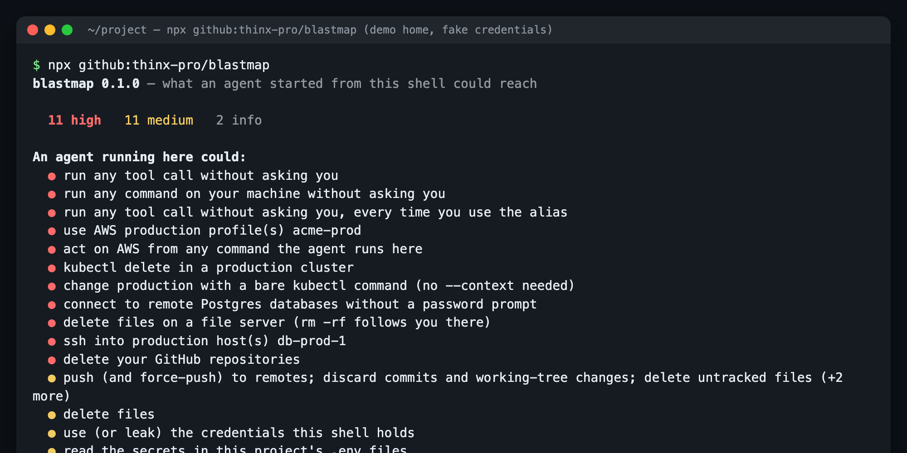

# blastmap

**What could your coding agent delete, publish or change right now?** One read-only command lists everything an agent started from your shell can reach: permission modes, logged-in cloud and Kubernetes CLIs, GitHub token scopes, publish tokens, unencrypted SSH keys, the Docker socket, mounted network shares, cloud-synced folders, and secret-looking env vars. Each item comes with a fix.

<!-- agent-preflight -->
> **Also a Claude Code skill.** `blastmap` is part of [agent-preflight](https://github.com/thinx-pro/agent-preflight), 16 offline checks for coding agents: `/plugin marketplace add thinx-pro/agent-preflight` then `/plugin install blastmap@agent-preflight`, and ask Claude in plain words.

    



<sub>Real output, run against a throwaway demo home (`scripts/demo-home.js`) with fake credentials. <a href="assets/demo-full.png">Full output</a>.</sub>

**No install?** Paste your `settings.json`, Codex `config.toml`, kubeconfig or `gh auth status` into the **[web checker](https://thinx-pro.github.io/blastmap/)**. It runs in your browser and uploads nothing.

## Why

Most agent accidents are about access, not intent. The agent runs one wrong command with credentials it never needed:

- The cyber-evaluation "escapes" reported by several labs this year were mostly **containment failures**: test environments with more network and credential access than intended. The [Cloud Security Alliance's note](https://labs.cloudsecurityalliance.org/research/csa-research-note-agentic-ai-evaluation-containment-risk-202/) says none involved a model breaking out of a properly configured sandbox. The security advice in the [coverage](https://www.secureworld.io/industry-news/rogue-ai-containment-failures) repeats one rule: an agent should never have more access than the task needs. (Hacker News thread: *"Containment and monitoring failures are to blame for AI hacking reports"*, 800+ points.)
- On a dev laptop, "the task needs" is usually *one repo*. But the shell you launch the agent from often holds a `delete_repo` GitHub token, a long-lived AWS key, a production `kubectl` context, an npm publish token, a mounted NAS and an iCloud-synced `~/Documents`. With `--dangerously-skip-permissions`, a Codex `danger-full-access` profile or `Bash(git:*)` in your allow list, nothing asks first.

Permission prompts and deny-list hooks guard individual commands. blastmap shows the other half: **what those commands could reach.** Run it before you leave an agent running overnight.

## Quick start

```bash
npx github:thinx-pro/blastmap
```

That's it. It needs Node 18+ and has no dependencies. Other forms:

```bash
npx github:thinx-pro/blastmap --json          # for agents and scripts
npx github:thinx-pro/blastmap --markdown      # paste into an issue / PR
npx github:thinx-pro/blastmap --strict        # exit 1 on any HIGH (pre-flight hook)
```

## What it checks

| Area | Checks | Reads |
|---|---|---|
| **Agent permissions** | Claude Code `defaultMode: bypassPermissions`, blanket `Bash` / `Bash(*)` allows, pre-approved risky prefixes (`git`, `rm`, `gh`, `kubectl`, `aws`, `terraform`, `docker`, `curl`, `npm publish`, …). Read-only narrowings such as `Bash(git status:*)` or `Bash(gh pr view:*)` are not flagged. Codex `danger-full-access` and `approval_policy = "never"` per profile. Shell aliases with `--dangerously-skip-permissions` / `--dangerously-bypass-approvals-and-sandbox` / `--yolo`. Configured MCP servers | `~/.claude/settings*.json`, `./.claude/settings*.json`, managed settings, `~/.codex/config.toml`, shell rc files, `~/.claude.json`, `./.mcp.json` |
| **Cloud & clusters** | AWS profiles with static keys (HIGH if a profile looks like prod), AWS creds in env, gcloud login + projects + ADC, Azure login, Vercel / Fly / DigitalOcean / Cloudflare / Supabase / Firebase / Terraform Cloud logins, `~/.netrc` hosts, kube contexts (HIGH for prod-looking and for a prod current-context) | Section and key **names** in credential files, never values |
| **Publish & hosting** | `gh` token scopes per account (`delete_repo` and `admin:org` → HIGH, `repo`, `workflow`), GitHub/npm tokens in env, npm / PyPI / crates.io / RubyGems tokens, Docker registries with inline auth | `gh auth status`, presence of token lines |
| **This machine** | Writable Docker socket (root on Linux), passwordless `sudo` right now, SSH private keys **without a passphrase**, keys loaded in `ssh-agent`, prod-looking hosts in `~/.ssh/config` | `sudo -n true`, the key's cipher header (`none` vs encrypted), `ssh-add -l` count |
| **Files deletes reach** | Writable network shares (SMB/NFS/AFP/sshfs/rclone mounts), writable external drives, cloud-synced folders (Dropbox, Google Drive, OneDrive, iCloud Drive, iCloud Desktop & Documents), rclone remotes, age of the last Time Machine backup | `mount`, `~/Library/CloudStorage`, `tmutil latestbackup` |
| **Secrets & databases** | Secret-looking env var **names**, `DATABASE_URL`-style vars pointing at a non-local host (the host is classified, not printed), `~/.pgpass` entries (HIGH if non-local), `~/.my.cnf` passwords, `.env` files in the project | Names, counts, local vs remote |

**Privacy.** blastmap never prints a secret value, token or password. Paths under your home show as `~` and email addresses as `<email>`. It writes nothing and makes no network requests. The only commands it runs are `gh auth status`, `ssh-add -l`, `sudo -n true` (fails silently when a password is needed), `mount` and `tmutil latestbackup`. `--no-exec` skips all of them.

## Options

```
--json            Machine-readable output (findings + "could" list + counts)
--markdown        Markdown table
--only AREAS      agent,cloud,publish,host,files,data
--cwd DIR         Project directory to check (default: current directory)
--no-exec         Skip checks that run commands
--strict          Exit 1 if any HIGH finding
--no-color        Plain text
```

## Use it with an agent

**Claude Code Skill.** Copy [`skill/blast-check/`](skill/blast-check/SKILL.md) to `~/.claude/skills/blast-check/`. Then ask "check my blast radius before I leave this running". The skill runs the scan and lists the worst 3–5 reachable things, each with the smallest per-shell change that removes it (`unset AWS_PROFILE`, switch kube context, eject the backup drive, a project-local deny rule). It doesn't change credentials itself.

**Pre-flight in a script.** For unattended runs:

```bash
npx -y github:thinx-pro/blastmap --strict --only agent,cloud,files || { echo "shrink the blast radius first"; exit 1; }
```

## How it works

Every check is a small pure function in [`src/rules.js`](src/rules.js) (parse a config → findings). [`src/collect.js`](src/collect.js) finds the files and feeds them in. The web checker loads the same `rules.js` unchanged; a test checks that `docs/rules.js` matches the source byte for byte. Severity is deliberately simple:

- **HIGH**: can destroy or change production or shared data without a prompt. Examples: bypass modes, `delete_repo`, prod contexts and profiles, writable network shares, remote DB credentials, passwordless sudo.
- **MEDIUM**: broad, but not obviously production. Examples: long-lived keys, publish tokens, unencrypted SSH keys, synced folders, risky allow rules.
- **info**: context, such as MCP servers, non-prod contexts and SSO profiles.

"Looks like production" means the name matches `prod|production|prd|live` as a word. It's a heuristic, and it's shown so you can judge it.

## Limitations & roadmap

- It sees **this shell**: its environment, its user and its mounts. An agent started from another terminal, an IDE or a launchd job may have different access. Run blastmap from there too.
- Credential detection is by known file locations. Tools that keep tokens only in the OS keychain (some `gh` setups, Docker credential helpers) appear only through their CLI status, or not at all.
- It does not test what a token can actually do server-side. A `repo`-scoped token on an account with no write access is still flagged.
- Not yet covered: Gemini CLI / Cursor / OpenCode permission files, Windows, 1Password/`op` sessions, browser sessions used by agent browser tools, cloud IAM policy analysis.
- Planned: `--diff` against a saved baseline, a `blastmap shrink` that prints a ready-to-source "clean shell" script, and more agent config formats. Issues with real configs that were misread are very welcome.

Tests: `npm test` (node:test, 18 tests, including a no-leak check that every output format is free of home paths, credential values and env values).

## License

MIT
